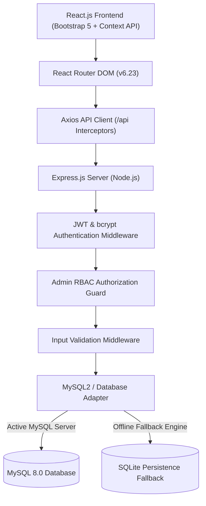
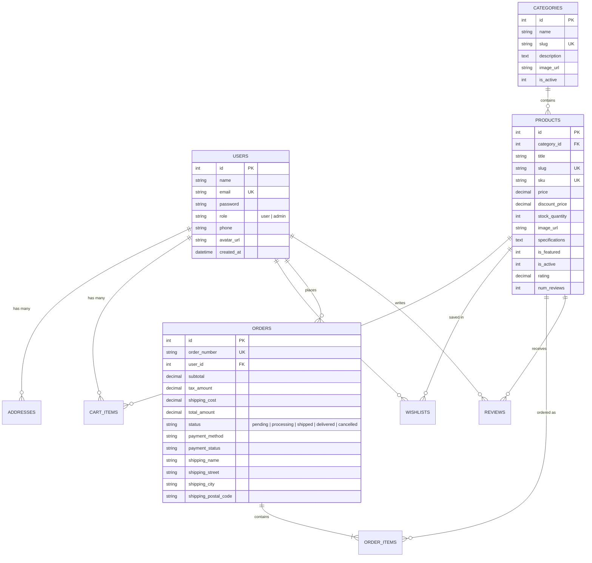

# ApexTech — Full-Stack E-Commerce Platform

[](https://nodejs.org/)
[](https://expressjs.com/)
[](https://react.dev/)
[](https://getbootstrap.com/)
[](https://www.mysql.com/)
[](LICENSE)

A production-grade, enterprise-ready **Full-Stack E-Commerce Platform** designed for high-performance computing, audio engineering, and modern lifestyle electronics. Built from scratch with **React 18**, **Express.js**, **MySQL2**, and **Bootstrap 5**, tailored for international portfolio demonstration and technical interviews.

---

## 🌟 Key Highlights

- **Zero Vite / Zero Tailwind Dependency**: Custom, ultra-fast **Webpack 5 + Babel** frontend build setup adhering strictly to enterprise vanilla CSS and Bootstrap 5 standards.
- **Server-Side Price & Inventory Integrity**: Unit prices, discount deductions, tax rates, and inventory limits are verified and calculated on the server—never trusting client-side totals.
- **Role-Based Access Control (RBAC)**: Secure separation between customer shoppers and store administrators with signed JSON Web Tokens (JWT) and bcrypt password hashing.
- **Universal Database Engine**: Built for MySQL 8.0 with `mysql2/promise` connection pooling, coupled with an intelligent auto-fallback engine (SQLite) so evaluators can run the entire project with zero external database configuration.
- **Full Shopping Lifecycle**: Real-time product search, filtering, category navigation, multi-image view, dynamic shopping cart, saved wishlist, address book, simulated test checkout, order confirmation receipts, and tracking timelines.
- **Comprehensive Admin Control Center**: Metrics dashboard, sales analytics by department, low-stock notifications, complete Product CRUD, Category CRUD, customer CRM, and live order fulfillment status updater.

---

## 🏗️ System Architecture



---

## 🗄️ Database Entity-Relationship Diagram (ERD)



---

## 💻 Tech Stack Summary

| Layer | Technologies Used |
| :--- | :--- |
| **Frontend** | React 18, React Router DOM v6, Bootstrap 5.3, Bootstrap Icons, Axios, React Context API |
| **Build System** | Webpack 5, Babel 7 (`@babel/preset-env`, `@babel/preset-react`), CSS Loader, HTML Webpack Plugin |
| **Backend** | Node.js (v18 - v24), Express.js 4.19, CORS, Morgan, Dotenv |
| **Authentication** | JSON Web Tokens (`jsonwebtoken`), `bcryptjs` (Salt Rounds: 10) |
| **Database** | MySQL 8.0, `mysql2/promise` with Connection Pooling, SQLite3 compatibility fallback |
| **Containerization** | Docker, Docker Compose (`mysql:8.0` image with auto-initialization scripts) |

---

## ⚡ Quick Start Guide

### 1. Clone & Install Dependencies

```bash
# Clone the repository
git clone https://github.com/your-username/apextech-ecommerce.git
cd apextech-ecommerce

# Install backend dependencies
cd backend
npm install

# Install frontend dependencies
cd ../frontend
npm install
```

### 2. Configure Environment Variables

**Backend (`backend/.env`)**:
```env
PORT=5000
NODE_ENV=development

# MySQL Credentials
DB_HOST=localhost
DB_PORT=3306
DB_USER=root
DB_PASSWORD=root
DB_NAME=apextech_ecommerce

# Security
JWT_SECRET=super_secret_jwt_key_apextech_2026_portfolio_secure_token
JWT_EXPIRES_IN=7d
CLIENT_URL=http://localhost:3000
```

**Frontend (`frontend/.env`)**:
```env
REACT_APP_API_URL=/api
```

### 3. Database Setup (Choose Option A or B)

#### Option A: Zero-Config Auto-Fallback (Instant Launch)
If you do not have MySQL running locally, simply launch the backend! The integrated persistent SQL engine automatically initializes all tables (`schema.sql`) and populates 12 curated hardware products, categories, reviews, and test accounts.

#### Option B: Live MySQL 8.0 / Docker
If you have MySQL or Docker installed:
```bash
# Start MySQL via Docker in 1 command:
docker compose up -d

# Or import scripts manually into MySQL Workbench / CLI:
# mysql -u root -p < backend/database/schema.sql
# mysql -u root -p < backend/database/seed.sql
```

### 4. Run the Application

In terminal 1 (Start Backend Server):
```bash
cd backend
npm start
# Server active on: http://localhost:5000
# API Health Check: http://localhost:5000/api/health
```

In terminal 2 (Start React Frontend):
```bash
cd frontend
npm start
# Client active on: http://localhost:3000
```

---

## 🔑 Demo & Test Credentials

For quick recruiter evaluations, the login page features **1-Click Quick Demo Login** buttons:

| Role | Email | Password | Privileges |
| :--- | :--- | :--- | :--- |
| **Administrator** | `admin@apextech.com` | `Admin@123` | Full access to `/admin` dashboard, product/category CRUD, order fulfillment |
| **Customer** | `john@example.com` | `Customer@123` | Cart, wishlist, addresses, test checkout, order history |

---

## 📑 REST API Documentation

### Authentication (`/api/auth`)
- `POST /api/auth/register` — Register customer account (name, email, password, phone).
- `POST /api/auth/login` — Sign in with email & password, returns JWT token & user profile.
- `GET /api/auth/me` — Retrieve current authenticated user profile.
- `PUT /api/auth/profile` — Update name, phone, or avatar image.
- `PUT /api/auth/change-password` — Verify current password and update to new password.

### Products (`/api/products`)
- `GET /api/products` — List products with search (`q`), category (`category`), price range (`min_price`, `max_price`), sorting (`newest`, `price_asc`, `price_desc`, `rating`, `popular`), and pagination.
- `GET /api/products/featured` — Fetch top editor's choice flagship items.
- `GET /api/products/:idOrSlug` — Retrieve detailed specifications, image gallery, and verified reviews.
- `GET /api/products/:id/related` — Fetch 4 comparable items in the same department.
- `POST /api/products/:id/reviews` — Submit verified customer review with rating (1-5) and comment *(Auth required)*.

### Cart & Wishlist (`/api/cart`, `/api/wishlist`)
- `GET /api/cart` — Retrieve user's cart items with stock and subtotal *(Auth required)*.
- `POST /api/cart` — Add product to cart or increment quantity *(Auth required)*.
- `PUT /api/cart/:id` — Update item quantity with stock validation *(Auth required)*.
- `DELETE /api/cart/:id` — Remove item from cart *(Auth required)*.
- `DELETE /api/cart` — Clear entire shopping bag *(Auth required)*.
- `POST /api/cart/sync` — Synchronize guest local cart with database on login.
- `GET /api/wishlist` — View saved hardware *(Auth required)*.
- `POST /api/wishlist/toggle` — Add or remove product from wishlist *(Auth required)*.

### Orders & Checkout (`/api/orders`)
- `POST /api/orders` — Create order with server-side price calculation, tax computation, stock decrement, and cart clearance *(Auth required)*.
- `GET /api/orders` — View customer's order history *(Auth required)*.
- `GET /api/orders/:idOrNumber` — Retrieve itemized receipt and tracking status *(Auth required)*.
- `PUT /api/orders/:id/cancel` — Cancel order and automatically restore product inventory *(Auth required)*.

### Admin Operations (`/api/admin`) *(Admin RBAC Required)*
- `GET /api/admin/stats` — Revenue metrics, order distribution, customer count, low-stock warnings, and category revenue.
- `POST /api/admin/products` — Add new hardware item with specifications and images.
- `PUT /api/admin/products/:id` — Update product details, inventory, and storefront visibility.
- `DELETE /api/admin/products/:id` — Delete product from store.
- `POST /api/admin/categories` — Create store department.
- `PUT /api/admin/categories/:id` — Edit store department.
- `DELETE /api/admin/categories/:id` — Delete empty department.
- `GET /api/admin/orders` — View all orders with search, status filtering, and pagination.
- `PUT /api/admin/orders/:id/status` — Advance order status (`pending`, `processing`, `shipped`, `delivered`, `cancelled`).
- `GET /api/admin/customers` — Customer CRM table with lifetime spend and order history counts.

---

## 🧪 Testing Verification

An automated verification test script is included to validate the full API lifecycle:

```bash
cd backend
npm run test:api
```

**Verification output:**
```
✓ Health Check: PASSED
✓ Customer Login: PASSED
✓ Admin Login: PASSED
✓ Products Search (q=macbook): PASSED
✓ Categories Listing: PASSED
✓ Add to Cart & Calculation: PASSED
✓ Wishlist Toggle: PASSED
✓ Create Order (Checkout): PASSED
✓ Admin Dashboard Stats: PASSED
🎉 ALL BACKEND API TESTS VERIFIED SUCCESSFULLY!
```

---

## 📦 Production Build

To build the optimized static production bundle:
```bash
cd frontend
npm run build
```
The production bundle is compiled into `frontend/dist/`. When the backend runs in production mode (`NODE_ENV=production`), Express automatically serves this optimized bundle, allowing you to run the entire full-stack app from a single port (`5000`)!

---

## 🛡️ Security & Best Practices

- **Zero Plain-Text Passwords**: Passwords hashed using `bcrypt` with salt rounds of 10.
- **SQL Injection Prevention**: 100% of SQL statements utilize parameterized queries (`?`).
- **Secret Protection**: All JWT keys, ports, and database credentials remain strictly in `.env` files; `.env.example` is committed to version control.
- **Strict Role-Based Middleware**: Sensitive administrator routes verify both token authenticity and the `role === 'admin'` attribute.
- **Server Price Validation**: Clients only submit product IDs and quantities; prices and totals are strictly determined by database state.

---

## 📄 License
This project is open-source and available under the [MIT License](LICENSE).
